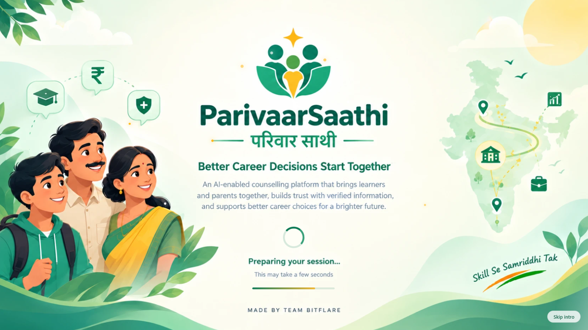
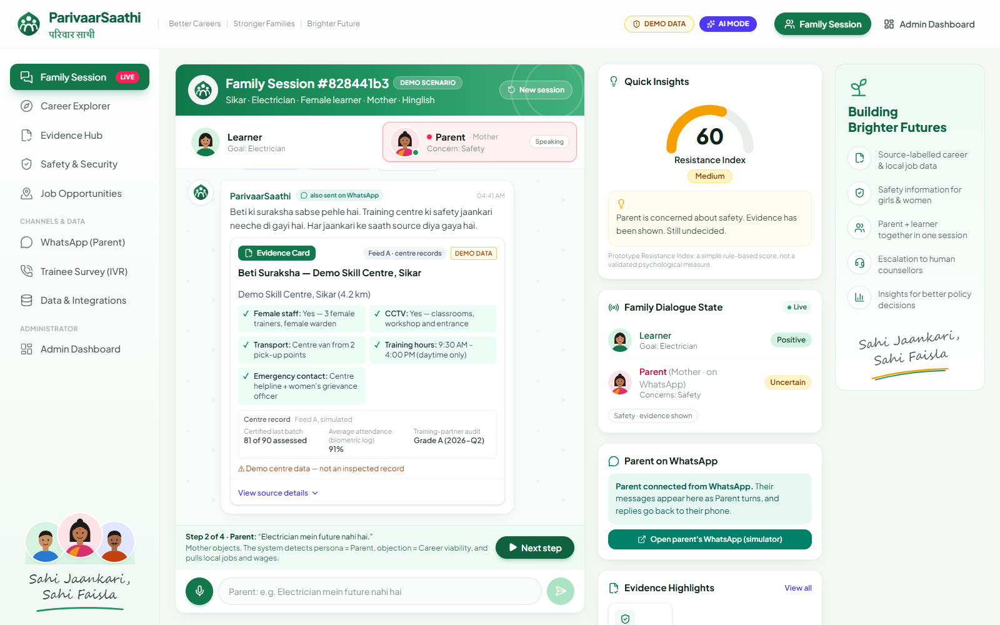
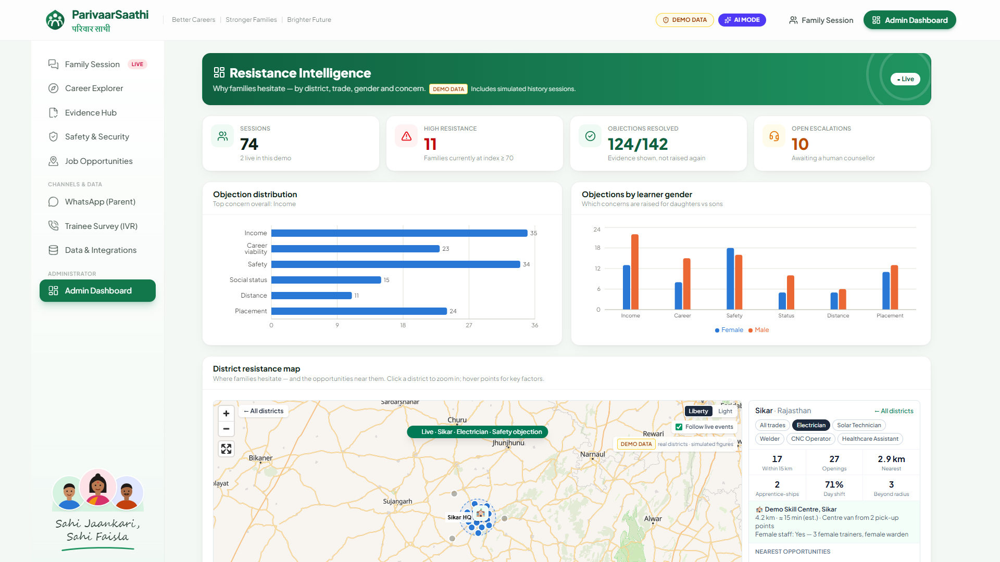
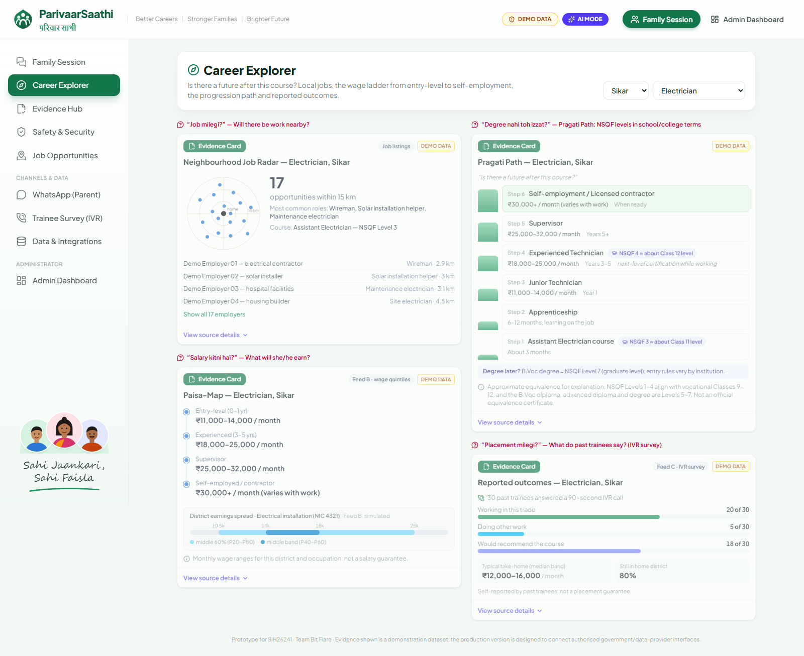
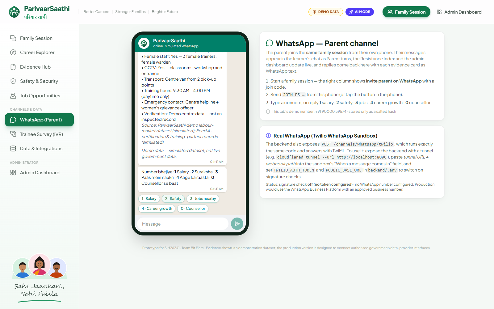
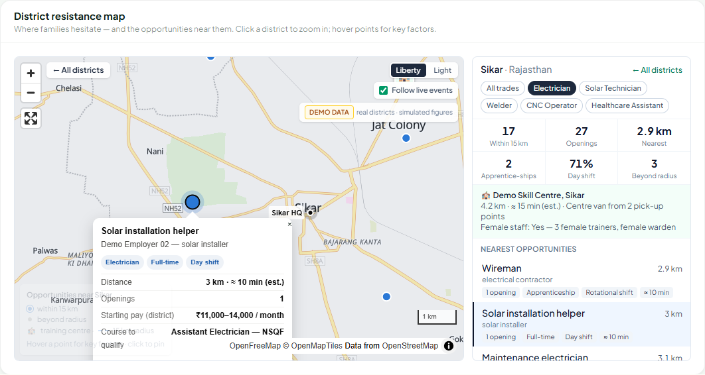
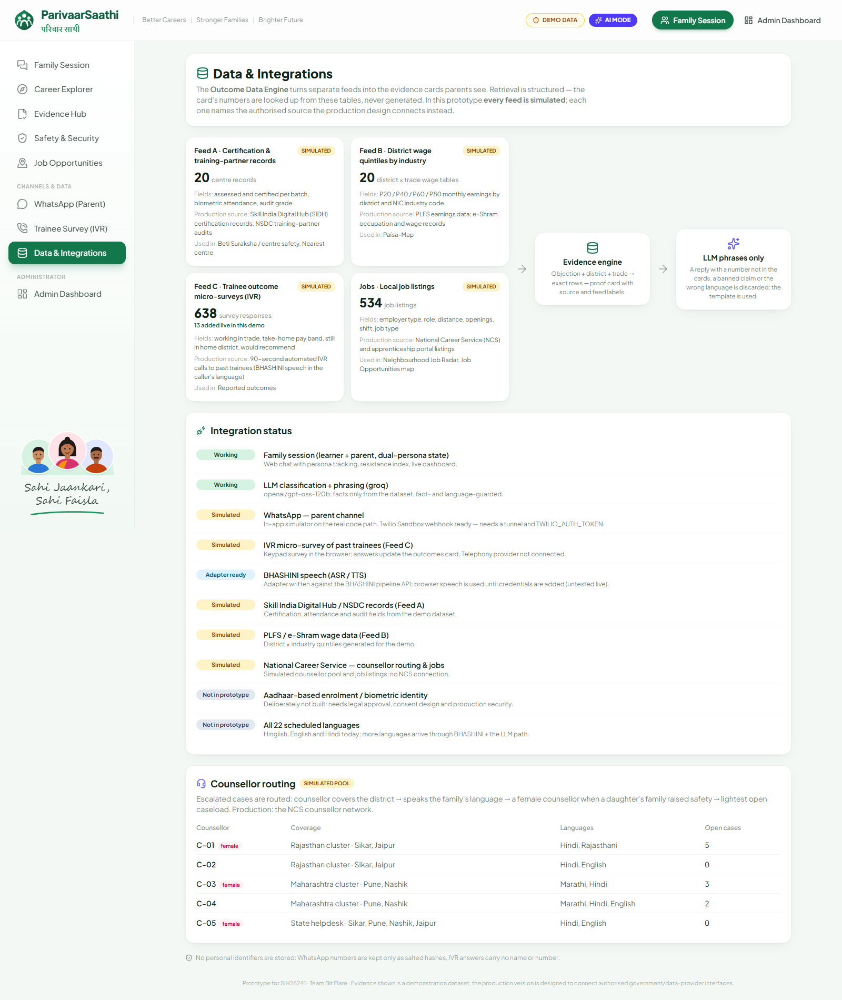

# ParivaarSaathi (परिवार साथी) — SIH26241 · Team Bit Flare

> **ParivaarSaathi doesn't just recommend careers — it helps families trust them.**



 
 
 

A 24-hour prototype of an AI family career-decision platform. The learner and the parent join the
**same** counselling session; the system detects the parent's specific objection, answers it with
source-labelled local evidence (never with generic persuasion), escalates unresolved cases to a
human counsellor with a warm-handoff brief, and streams every objection as anonymised resistance
intelligence to an administrator dashboard.

Source of truth for the product: [`docs/ParivaarSaathi_Claude_24H_Master_Context.md`](docs/ParivaarSaathi_Claude_24H_Master_Context.md).
Judge-facing demo script: [`docs/DEMO_SCRIPT.md`](docs/DEMO_SCRIPT.md).
What is working, simulated, or deliberately out of scope: [`docs/CLAIMS_AND_INTEGRATIONS.md`](docs/CLAIMS_AND_INTEGRATIONS.md).

> **Demo data notice:** every number shown is from a clearly labelled, *simulated* demonstration dataset. The production
> design connects authorised government and data-provider interfaces; this prototype does not.

## Screenshots

| Family session (learner + parent, live evidence) | Admin dashboard (resistance intelligence) |
|---|---|
|  |  |
| **Career Explorer: Pragati Path, Paisa-Map, outcomes** | **Parent on WhatsApp (simulator)** |
|  |  |
| **District map with nearby opportunities** | **Data & Integrations (honest status)** |
|  |  |

## Tech stack

| Layer | Technology |
|---|---|
| Frontend | React 18, Vite, Tailwind CSS v4, Recharts, MapLibre GL + OpenFreeMap, lucide-react |
| Backend | Python, FastAPI, WebSocket, Pydantic, SQLite (stdlib `sqlite3`) |
| AI (optional) | One `llm_service.py` for Groq (free tier) / Anthropic Claude / any OpenAI-compatible endpoint; facts only from the dataset |
| Channels | Web chat; WhatsApp (in-app simulator + Twilio Sandbox webhook); IVR survey (simulated) |
| Speech | Browser Web Speech API; BHASHINI adapter (needs credentials) |

## Repository structure

```
Parivaar_Saathi/
├── backend/                 FastAPI app (see backend/README.md)
│   ├── app/                 main.py, config, db, seed data, services/
│   ├── requirements.txt
│   └── .env.example         copy to .env (git-ignored) to configure keys
├── frontend/                React app (see frontend/README.md)
│   ├── index.html           animated intro
│   ├── public/              intro artwork, favicon
│   └── src/                 components/, pages/, lib/
├── docs/                    master context, implementation plan, demo script, claims, screenshots/
├── scripts/start-dev.ps1    opens backend + frontend in two terminals (Windows)
├── Dockerfile               one container: builds the frontend, serves it + the API (free deploy)
├── render.yaml              Render Blueprint (free web service)
└── README.md
```

---

## Run it

Prerequisites: Node 18+ and Python 3.11+ (tested on Node 24 / Python 3.14, Windows 11).

```powershell
# one-time setup
cd backend
python -m venv .venv
.\.venv\Scripts\python.exe -m pip install -r requirements.txt
copy .env.example .env          # optional: add GROQ_API_KEY (free) for AI mode; .env is git-ignored
cd ..\frontend
npm install
```

```powershell
# every time — two terminals (or run scripts\start-dev.ps1, which opens both)
cd backend;  .\.venv\Scripts\python.exe -m uvicorn app.main:app --port 8000
cd frontend; npm run dev        # → http://localhost:5173
```

Open **http://localhost:5173** for the family session and **http://localhost:5173/#dashboard** in a
second tab for the administrator dashboard. The dashboard updates live over a WebSocket.

Each page load opens with an animated intro (about 4.5 s): the artwork in `frontend/public/intro.webp` (JPEG fallback)
with a circular reveal, slow drift, light sweep, glowing star and sun, rising sparkles, a live spinner and a progress bar.
The app loads underneath and is revealed when it ends. All motion is CSS in `frontend/index.html`; timing in `src/lib/intro.js`.
**Skip intro** or Esc skips it; `http://localhost:5173/?intro=0#dashboard` opens straight into the app (handy for the
second demo tab and rehearsals). The parent's WhatsApp invite link never shows it.

### Views (left sidebar — every item is a working view)

| Hash | View | What it shows |
|---|---|---|
| `#session` | **Family Session** | Session setup / Demo Scenario launcher, then the family chat: participant cards (tap to choose who is speaking), illustrated message bubbles, evidence cards, quick parent asks, mic; right column with the Resistance Index gauge, family dialogue state, highlights of evidence actually shown, and next steps / human counsellor request |
| `#career` | **Career Explorer** | Job Radar, Paisa-Map (with Feed B earnings spread), **Pragati Path** (NSQF levels in school/college terms) and reported outcomes from the IVR survey, for any district × trade |
| `#evidence` | **Evidence Hub** | Every proof card, each labelled with the parent question it answers |
| `#safety` | **Safety & Security** | Beti Suraksha / centre safety and nearest-centre cards |
| `#jobs` | **Job Opportunities** | The interactive district map, opening on the current session's district and trade |
| `#whatsapp` | **WhatsApp (Parent)** | Simulated WhatsApp phone: the parent sends `JOIN PS-…` and joins the *same* family session; turns appear live in the web chat. Also documents the real Twilio Sandbox webhook |
| `#survey` | **Trainee Survey (IVR)** | Feed C: a 90-second keypad IVR call to a past trainee (Hindi/English prompts, spoken by the browser or BHASHINI); answers update the "Reported outcomes" card at once |
| `#feeds` | **Data & Integrations** | The Outcome Data Engine's feeds (A/B/C + jobs) with record counts, an honest integration-status list, and the simulated counsellor-routing pool |
| `#dashboard` | **Admin Dashboard** | Resistance intelligence (KPIs, charts, map, live feed, counsellor queue) |

> On Windows, run uvicorn **without** `--reload` — the reloader can leave orphan workers holding port 8000.

### Modes

| Mode | When | What happens |
|---|---|---|
| **Demo Scenario Mode** (default) | No `ANTHROPIC_API_KEY`, or `APP_MODE=demo` | Keyword rules classify objections; Hinglish/English templates phrase the replies. Fully deterministic. |
| **AI mode** | Key present and `APP_MODE=auto` | The configured model classifies the message into structured JSON and phrases the reply **around the retrieved evidence**. Replies that contain a number not present in the evidence, or a banned claim, are discarded and the template is used. Any failure or timeout (`LLM_TIMEOUT`, default 25 s) falls back the same way. |

The **▶ Run demo scenario** button always uses the deterministic path, so the scripted story is
repeatable even when AI mode is on. Free-typed sessions can opt out of AI per session.

### Enabling AI mode with Groq (free tier) — recommended

1. Create a key at <https://console.groq.com/keys> (free tier, no card required at the time of writing — check current limits).
2. In `backend/.env` set `LLM_PROVIDER=groq` and paste the key into `GROQ_API_KEY=`.
3. Restart the backend. Open <http://localhost:8000/health/llm> — it makes one tiny real call and returns
   `"ok": true` with the latency, or the exact error (bad key, model renamed, no internet).
4. Refresh the browser: the header badge reads **AI mode** (hover it to see the model), and free-typed sessions show an
   **AI-phrased · facts from dataset** chip on replies.

Default Groq model is `openai/gpt-oss-120b` (best Hinglish of the models on Groq's free tier at the time of writing;
`openai/gpt-oss-20b` is faster, `qwen/qwen3.8-27b` is another option). Groq changes its catalogue often — if
`/health/llm` reports `model_not_found`, set `LLM_MODEL=` to a current id from <https://console.groq.com/docs/models>
(or `GET https://api.groq.com/openai/v1/models` with your key). Free-tier rate limits only affect free-typed sessions —
the scripted demo never calls the LLM.

Other providers: `LLM_PROVIDER=anthropic` with `ANTHROPIC_API_KEY` (default `claude-opus-5-5`), or
`LLM_PROVIDER=openai_compatible` with `LLM_BASE_URL` for any OpenAI-style endpoint such as a local Ollama
(`http://127.0.0.1:11434/v1`, no key). All three go through the same `llm_service.py`; nothing else changes.

---

## Deploy for free

One free Render web service runs the whole app (API, WebSocket and frontend on one URL). In Render, choose
**New → Blueprint**, pick this repository and enter your `GROQ_API_KEY` (or leave it empty for Demo mode). The included
`Dockerfile` and `render.yaml` do the rest. Full steps and free-plan caveats: [`docs/DEPLOYMENT.md`](docs/DEPLOYMENT.md).

---

## The core loop (what to look for)

```
Learner goal → Parent objection → Objection detection → Evidence retrieval → Proof card
      → Prototype Resistance Index changes → live admin dashboard event → human escalation
```

1. **Family chat** — one WhatsApp-style thread, a Learner/Parent switch, a detection chip under each
   parent message (persona · objection · refusal), proof cards with a source chip and a **Demo data** badge.
2. **Evidence cards** — Neighbourhood Job Radar, Paisa-Map (wage progression), Beti Suraksha (centre safety),
   Career Roadmap, reported outcomes, nearest centre. All values come from the dataset in
   `backend/app/seed_data.py`; the LLM never supplies facts.
3. **Prototype Resistance Index** — a simple deterministic score (start 60; objection +15; repeat +10;
   refusal +20; evidence shown −15; acceptance −20; bands High ≥ 70 / Medium 40–69 / Low < 40).
   It is *not* a validated psychological measure and is labelled as such in the UI.
4. **Human escalation** — fires when the index is ≥ 70 **and** either ≥ 2 concerns are unresolved or the
   parent refuses after evidence was shown; also available on demand ("Talk to a counsellor"). Produces a
   warm-handoff brief: learner, parent, district, trade, top concerns, evidence shown, remaining concern,
   suggested counsellor action, and what the parent said.
5. **Resistance Intelligence dashboard** — KPIs, objection distribution, objections by learner gender,
   an interactive **MapLibre district map** on the free **OpenFreeMap** basemap (Liberty / Light toggle, no API key),
   a district × objection heat table with per-trade summaries, live event feed, counsellor queue with briefs.

   *The map:* overview circles per district (size = sessions, colour = average resistance index) with hover
   effects and a synced "districts by resistance" list. Click a district (or let **Follow live events** do it when
   a chat objection arrives) and it auto-zooms to the 15 km radius, showing nearby opportunities and the training
   centre. Hovering a point — or its row in the side list — highlights both and opens its key factors (role,
   employer type, distance + est. commute, openings, job type, shift, district starting pay, course to qualify);
   click to pin and fly to it. Filter by trade, Ctrl/⌘ + scroll to zoom, fullscreen. Positions are illustrative
   (dataset distance from the district HQ, not real addresses) and labelled so; offline, the basemap falls back to a
   plain background and the markers still work. Data: `GET /map/opportunities?district=&trade=`.

6. **Channels, feeds and routing** — the parent can join from **WhatsApp** (simulator, or a real number through the
   Twilio WhatsApp Sandbox: expose the backend with a tunnel, point the sandbox at `/channels/whatsapp/twilio`, set
   `TWILIO_AUTH_TOKEN` + `PUBLIC_BASE_URL` for signature checks). Only salted hashes of phone numbers are stored. Every
   evidence card names its **feed** (A: certification/audit records, B: district wage quintiles, C: IVR survey of past
   trainees, jobs). All feeds are simulated; see [`docs/CLAIMS_AND_INTEGRATIONS.md`](docs/CLAIMS_AND_INTEGRATIONS.md).
   Escalations are **routed** to a simulated counsellor pool (district → language → female counsellor when a daughter's
   family raised safety → lightest caseload). LLM replies are also discarded if they are not in the session's language.

Voice: the mic button uses the browser's speech recognition where available (Chrome/Edge) and a clearly
labelled *simulated voice note* elsewhere; "Read replies aloud" uses browser speech synthesis. The
backend's ASR/TTS boundary (`backend/app/services/voice_service.py`) includes a BHASHINI adapter that switches on with
`BHASHINI_USER_ID` + `BHASHINI_API_KEY` (written against BHASHINI's pipeline API; not yet tested against the live service).

---

## Architecture

```
frontend/ (React 18 + Vite + Tailwind v4 + Recharts + MapLibre, lucide-react icons, Plus Jakarta Sans bundled offline)
  src/components/shell/     AppHeader · Sidebar · Logo · Avatar (inline-SVG illustrations) · PromoColumn
  src/components/insights/  InsightsColumn · ResistanceGauge
  src/components/           SessionSetup · FamilyChat · ProofCard + cards/ · HandoffBrief · Dashboard · DistrictMap
  src/pages/                EvidenceHub (also Career Explorer / Safety presets) · JobsPage · WhatsAppSim · IvrSurvey · DataFeeds
  src/lib/                  api.js · speech.js (browser ASR/TTS adapter) · demoScript.js · nav.js · labels.js · districts.js

backend/ (FastAPI + SQLite, Python)
  app/main.py                 REST + WebSocket endpoints
  app/services/pipeline.py    persona → classify → evidence → reply → resistance → escalation → events
  app/services/classifier.py  deterministic Hinglish/English keyword classifier
  app/services/llm_service.py the ONLY module that calls the LLM (classification, phrasing, fact-guard)
  app/services/evidence_engine.py  objection → dataset query → proof cards
  app/services/resistance.py  Prototype Resistance Index rules
  app/services/escalation.py  trigger rule + warm-handoff brief
  app/services/analytics.py   dashboard aggregates
  app/services/feeds.py       Outcome Data Engine feed registry (A/B/C + jobs, all simulated)
  app/services/surveys.py     Feed C: IVR micro-survey script, storage, aggregates
  app/services/channels.py    WhatsApp channel: JOIN codes, quick replies, cards as text, Twilio TwiML + signature check
  app/services/voice_service.py  browser speech / BHASHINI adapter
  app/seed_data.py            demonstration dataset (4 districts × 5 trades)
  app/seed_history.py         72 simulated history sessions run through the real pipeline
```

### API

| Method | Path | Purpose |
|---|---|---|
| POST | `/session` | start a family session (district, trade, learner gender, parent, language, use_llm) |
| POST | `/message` | one learner/parent turn → detection, reply, cards, resistance, escalation |
| GET | `/evidence?objection&district&trade&gender` | proof cards for an objection |
| POST | `/escalation` · GET `/escalations` · PATCH `/escalations/{id}` | manual escalation, counsellor queue, status |
| GET | `/dashboard/summary` · GET `/events/recent` | dashboard aggregates and recent events |
| GET | `/map/opportunities?district&trade` | nearby opportunities, training centre and key factors for the map (illustrative positions) |
| GET | `/data/feeds` · GET `/counsellors` | Outcome Data Engine feed status; simulated counsellor pool |
| GET | `/ivr/script` · POST `/ivr/responses` · POST `/ivr/simulate-round` · GET `/ivr/summary` | Feed C: IVR micro-survey |
| GET | `/session/{id}/channels` | join code and linked phones for a session |
| POST | `/channels/whatsapp/simulate` · POST `/channels/whatsapp/twilio` | WhatsApp: in-app simulator · Twilio Sandbox webhook (TwiML) |
| GET | `/voice/status` · POST `/voice/tts` | speech adapter status; BHASHINI TTS (503 → browser speech) |
| WS | `/events` | live events: `resistance_update`, `escalation_created`, `family_decision`, `survey_response`, `channel_joined`, `session_turn`, `session_escalation`, `reset` |
| POST | `/demo/reset` | rebuild the demo dataset and simulated history (rehearsals) |
| GET | `/health` · `/health/dependencies` · `/meta` | status, mode, model, districts/trades/languages |

---

## Data and claim discipline

- Every evidence record is **simulated** and labelled: "ParivaarSaathi demo labour-market dataset (simulated)".
  Employer names are generic ("Demo Employer 01 — electrical contractor"). The production design connects
  authorised government/data-provider interfaces (Skill India Digital Hub / NSDC, PLFS, NCS, centre data).
- Dashboard numbers include 72 **simulated history sessions** (flagged in the database and on screen) so
  the charts are not empty at the start of a demo. District concern mixes are demo assumptions, not findings.
- Wording we deliberately avoid anywhere in the product: "100% verified", "zero hallucination",
  "world's first", "guaranteed placement/salary", "AI replaces counsellors".

## Project docs

- `docs/ParivaarSaathi_Claude_24H_Master_Context.md` — master context (problem, USPs, architecture, plan)
- `docs/ParivaarSaathi_Understanding.md` — pre-build understanding and open questions
- `docs/IMPLEMENTATION_PLAN.md` — the 3-phase plan and the decisions taken on the open questions
- `docs/DEMO_SCRIPT.md` — demo flow and talking points for judges
- `docs/DEPLOYMENT.md`: free deployment on Render (Dockerfile + render.yaml)
- `docs/CLAIMS_AND_INTEGRATIONS.md` — every solution claim mapped to Working / Simulated / Adapter ready / Not built, with safe wording
